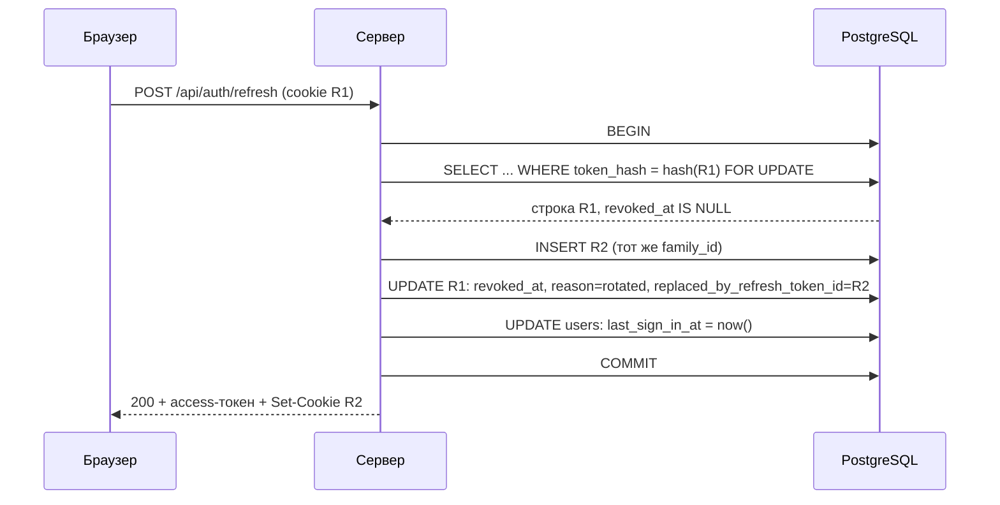

# shop_server

Backend-сервис интернет-магазина на Go.

> Актуальная аутентификация — email + пароль. Пакеты: `internal/account`,
> `internal/captcha`, `internal/mailer`, `internal/password`. Вход через
> Яндекс/VK/Telegram отложен: соцсети будут привязываться к аккаунту в профиле.

## Технологии

- **Go 1.26+**
- **PostgreSQL**
- **Chi** — HTTP-роутер
- **slog** — структурированное логирование

## Структура проекта

```
.
├── cmd/
│   └── shop_server/
│       └── main.go                  # Точка входа: config.Load → app.New → app.Run
├── internal/
│   ├── app/
│   │   ├── app.go                   # Сборка зависимостей, Run и Shutdown
│   │   └── router.go                # CORS, middleware, маршруты
│   ├── api/
│   │   ├── server.go                # Server с зависимостями, константы
│   │   ├── auth.go                  # refresh и logout, toUserDTO
│   │   ├── auth_email.go            # регистрация и вход по email
│   │   ├── password.go              # forgot / reset / change password
│   │   ├── profile.go               # профиль и обычные согласия
│   │   ├── captcha.go               # выдача капча-сессии
│   │   ├── request.go               # decodeJSON
│   │   ├── catalog.go               # каталог уроков
│   │   ├── health.go                # /healthz и /readyz
│   │   ├── video.go                 # HLS-манифест и AES-ключ (заглушки)
│   │   ├── payments.go              # вебхук Prodamus (заглушка)
│   │   ├── admin.go                 # загрузка видео (заглушка)
│   │   ├── cookies.go               # политика refresh-cookie
│   │   ├── middleware.go            # RequireAuth, RequireAdmin, лог запросов
│   │   ├── respond.go               # writeJSON / writeError
│   │   ├── errors.go                # HTTP-коды и тексты ошибок
│   │   ├── dto.go                   # UserDTO, запросы и ответы auth
│   │   └── yandex.go                # пустая заглушка, публичный вход удалён
│   ├── account/
│   │   ├── interfaces.go            # UserStore, CaptchaVerifier, Mailer, TokenIssuer
│   │   ├── service.go               # Register, Login, Forgot/Reset/ChangePassword
│   │   └── service_test.go
│   ├── captcha/
│   │   ├── policy.go                # профили desktop/mobile и пороги
│   │   ├── validate.go              # геометрия, ритм, page time
│   │   ├── service.go               # Issue, VerifyAndConsume, points_hash
│   │   ├── errors.go
│   │   └── validate_test.go
│   ├── mailer/
│   │   ├── mailer.go                # Sender, Message, PasswordResetMessage
│   │   ├── log.go                   # dev-sender
│   │   └── smtp.go                  # SMTP: starttls / tls / none
│   ├── password/
│   │   ├── password.go              # bcrypt cost 12, dummy hash
│   │   └── password_test.go
│   ├── auth/
│   │   ├── jwt.go                   # access-токены
│   │   ├── jwt_test.go
│   │   ├── refresh.go               # opaque refresh-токены и хеши
│   │   ├── refresh_test.go
│   │   ├── service.go               # IssuePair / Rotate / Revoke
│   │   └── context.go               # claims в контексте
│   ├── authn/
│   │   └── provider.go              # имена провайдеров входа и лимиты их колонок
│   ├── cleaner/
│   │   ├── cleaner.go               # фоновая очистка refresh-токенов
│   │   ├── cleaner_test.go
│   │   ├── policy.go                # окна хранения и таймаут прохода
│   │   └── policy_test.go
│   ├── config/
│   │   ├── config.go                # Config, Load, validate
│   │   ├── duration.go              # поддержка суффикса "d"
│   │   ├── field.go                 # рефлексия для env-тегов
│   │   ├── duration_test.go
│   │   └── validate_test.go
│   ├── logging/
│   │   ├── logger.go                # New, ParseLevel
│   │   ├── pretty.go                # человекочитаемый хендлер
│   │   ├── attrs.go                 # форматирование длительностей
│   │   ├── context.go               # request-scoped логгер
│   │   └── logger_test.go
│   ├── model/
│   │   ├── user.go                  # User, роли
│   │   ├── lesson.go                # Lesson, LessonPage
│   │   ├── token.go                 # RevokeReason, CleanupResult
│   │   ├── consent.go               # PIIConsent, RegularConsent
│   │   ├── captcha.go               # CaptchaPoint, CaptchaSession
│   │   ├── auth_token.go            # одноразовые токены
│   │   └── identity.go              # привязки соцсетей
│   ├── store/
│   │   ├── store.go                 # пул соединений
│   │   ├── errors.go                # DBError, коды, HasCode
│   │   ├── lessons.go               # каталог
│   │   ├── tokens.go                # refresh-токены и очистка
│   │   ├── token_policy.go          # grace-окно ротации
│   │   ├── users.go                 # пользователи и пароли
│   │   ├── captcha.go               # капча-сессии и активное PII-согласие
│   │   ├── auth_tokens.go           # одноразовые токены
│   │   ├── consents.go              # обычные согласия
│   │   ├── inet.go                  # inet и сравнение IP
│   │   ├── inet_test.go
│   │   └── token_policy_test.go
│   ├── textutil/
│   │   ├── truncate.go              # обрезка UTF-8 без разрыва руны
│   │   └── truncate_test.go
│   └── yandex/
│       ├── client.go                # legacy-клиент Яндекс.ID, не подключён
│       └── dto.go                   # DTO провайдера
├── migrations/
│   ├── 0001_init.sql                # схема shop.*
│   └── 0002_seed.sql                # справочники и демо-уроки
├── docs/
│   └── architecture.md              # карта кода, маршруты, «куда добавлять новое»
├── deploy/
│   └── Dockerfile                   # прод-образ: multi-stage, non-root
├── .github/workflows/ci.yml         # gofmt, vet, test, build
├── .devcontainer/
│   ├── Dockerfile                   # dev-контейнер для VS Code
│   └── devcontainer.json
├── Makefile                         # build/run/test/lint/migrate-up
├── .env.example
├── go.mod
├── go.sum
└── README.md
```

Правила зависимостей: `model` не импортирует ничего из проекта, `store` не знает
про HTTP и `config`, `api` не пишет SQL, `yandex` не знает про `http.ResponseWriter`,
`authn` содержит только контракт провайдеров и не импортирует `api` и `store`,
а `app` — единственное место, где всё собирается.

Подробная карта кода, маршруты запросов, таблица «было → стало» и инструкции
«куда добавлять новое» — в [`docs/architecture.md`](docs/architecture.md).

## Эндпоинты

| Метод | Путь | Описание | Доступ |
|---|---|---|---|
| `GET` | `/healthz` | Liveness-проба (процесс жив) | Публичный |
| `GET` | `/readyz` | Readiness-проба (проверяет БД) | Публичный |
| `GET` | `/lessons` | Каталог уроков (пагинация `page`, `pageSize`) | Публичный |
| `POST` | `/api/auth/captcha/session` | Выдача сессии капчи (`register` / `password_reset`) | Публичный |
| `POST` | `/api/auth/register` | Регистрация email + пароль + капча | Публичный |
| `POST` | `/api/auth/login` | Вход по email и паролю | Публичный |
| `POST` | `/api/auth/password/forgot` | Запрос сброса пароля (капча + email) | Публичный |
| `POST` | `/api/auth/password/reset` | Сброс пароля по одноразовому токену | Публичный |
| `POST` | `/api/auth/password/change` | Смена пароля | Приватный |
| `POST` | `/api/auth/refresh` | Новая пара токенов по refresh-cookie | Публичный |
| `POST` | `/api/auth/logout` | Удаление сессии и очистка cookie | Публичный |
| `GET` | `/api/profile` | Профиль и обычные согласия | Приватный |
| `PUT` | `/api/profile/regular-consents/{regular_consent_id}` | Включить/отключить обычное согласие | Приватный |
| `POST` | `/Prodamus/webhook` | Вебхук платёжной системы | Публичный |
| `GET` | `/api/videos/{videoID}/stream.m3u8` | HLS-манифест видео | Приватный |
| `GET` | `/api/videos/key/{videoID}` | AES-ключ шифрования | Приватный |
| `POST` | `/api/admin/video/upload` | Загрузка видео | Админ |

Вебхук, видео и загрузка пока не реализованы и отвечают `501 NOT_IMPLEMENTED`
(а не `200` с пустым телом): платёжная система и клиент должны видеть, что
обработчик не готов.

## Middleware

| Middleware | Назначение |
|---|---|
| `RequestID` | Генерация ID запроса для трейсинга |
| `ClientIPFromRemoteAddr` | Определение IP клиента для логов и сессий |
| `RequestLogger` | Логирование запросов и request-scoped логгер в контекст |
| `Recoverer` | Защита от panic |
| `Timeout` | Таймаут обработки запроса, значение из `HTTP_SERVER_REQUEST_TIMEOUT` |
| `RequireAuth` | Проверка Bearer access-токена |
| `RequireAdmin` | Проверка роли `admin` (ставится после `RequireAuth`) |

## Запуск

### Локально

1. Убедитесь, что PostgreSQL запущен, и примените миграции:

```bash
make migrate-up
# или вручную:
# psql "$DATABASE_URL" -f migrations/0001_init.sql
# psql "$DATABASE_URL" -f migrations/0002_seed.sql
```

2. Задайте переменные окружения (см. ниже, шаблон — `.env.example`).
3. Запустите:

```bash
go run ./cmd/shop_server
# или
make run
```

Точка входа — `cmd/shop_server/main.go`, поэтому `go run main.go` из корня больше
не используется: в корне нет Go-файлов, весь код лежит в `internal/`.

### В контейнере (VS Code Dev Containers)

1. Установите расширение **Dev Containers**.
2. `Command Palette` → `Dev Containers: Reopen in Container`.
3. В терминале контейнера:

```bash
go run ./cmd/shop_server
```

## Переменные окружения

Имена сгруппированы по префиксу: префикс обозначает область, к которой относится
параметр. «Обязательная = Да» означает, что у переменной нет значения по умолчанию
и без неё приложение не стартует (`config load failed` со списком пропусков).

### Логирование

| Переменная | Обязательная | Описание |
|---|---|---|
| `LOG_SERVICENAME` | Нет | Имя сервиса в логах (по умолчанию `shop_server`) |
| `LOG_LEVEL` | Нет | `debug`, `info`, `warn`, `error` (по умолчанию `info`); `debug` включает человекочитаемый вывод |

### Приложение

| Переменная | Обязательная | Описание |
|---|---|---|
| `APP_PORT` | Нет | Порт HTTP-сервера (по умолчанию `8000`) |
| `APP_SHUTDOWN_TIMEOUT` | Нет | Сколько ждём завершения активных запросов при остановке (по умолчанию `10s`) |

### HTTP-сервер (входящие запросы)

| Переменная | Обязательная | Описание |
|---|---|---|
| `HTTP_SERVER_READ_HEADER_TIMEOUT` | Нет | Таймаут чтения заголовков запроса (по умолчанию `10s`) |
| `HTTP_SERVER_READ_TIMEOUT` | Нет | Таймаут чтения запроса целиком (по умолчанию `30s`), не меньше `HTTP_SERVER_READ_HEADER_TIMEOUT` |
| `HTTP_SERVER_WRITE_TIMEOUT` | Нет | Таймаут записи ответа (по умолчанию `75s`), не меньше `HTTP_SERVER_REQUEST_TIMEOUT` |
| `HTTP_SERVER_IDLE_TIMEOUT` | Нет | Таймаут keep-alive соединения (по умолчанию `120s`) |
| `HTTP_SERVER_REQUEST_TIMEOUT` | Нет | Таймаут обработки одного запроса, `chi middleware.Timeout` (по умолчанию `60s`) |

### HTTP-клиент (внешние запросы)

| Переменная | Обязательная | Описание |
|---|---|---|
| `HTTP_CLIENT_TIMEOUT` | Нет | Таймаут исходящих запросов к внешним провайдерам (по умолчанию `5s`) |

### PostgreSQL

| Переменная | Обязательная | Описание |
|---|---|---|
| `DB_HOST` | Нет | Хост PostgreSQL (по умолчанию `localhost`) |
| `DB_PORT` | Нет | Порт PostgreSQL (по умолчанию `5432`) |
| `DB_NAME` | **Да** | Имя базы данных |
| `DB_SCHEMA` | **Да** | Схема БД |
| `DB_USER` | **Да** | Пользователь PostgreSQL |
| `DB_PASSWORD` | **Да** | Пароль PostgreSQL |
| `DB_CONNECT_TIMEOUT` | Нет | Таймаут установки соединения при старте и для каждого соединения в пуле (по умолчанию `5s`) |
| `DB_POOL_MAX_CONNS` | Нет | Максимум соединений в пуле (по умолчанию `25`) |
| `DB_QUERY_TIMEOUT` | Нет | Таймаут одного похода в БД из хендлера (по умолчанию `5s`) |

### JWT: подпись и access-токен

| Переменная | Обязательная | Описание |
|---|---|---|
| `JWT_SECRET` | **Да** | Секрет подписи, минимум 32 символа |
| `JWT_ISSUER` | Нет | Издатель токена (по умолчанию `shop_server`) |
| `JWT_ACCESS_TTL` | Нет | Время жизни access-токена (по умолчанию `15m`) |
| `JWT_ACCESS_LEEWAY` | Нет | Допуск на расхождение часов между инстансами при проверке access-токена (по умолчанию `30s`; `0` отключает допуск) |

### Refresh-токен (opaque, не JWT)

| Переменная | Обязательная | Описание |
|---|---|---|
| `REFRESH_TOKEN_TTL` | Нет | Время жизни refresh-токена и cookie (по умолчанию `720h`) |
| `REFRESH_TOKEN_BYTES` | Нет | Размер энтропии токена в байтах, от 16 до 64 (по умолчанию `32`) |
| `REFRESH_TOKEN_ROTATION_GRACE_PERIOD` | Нет | Окно, в котором повтор ротированного токена с того же IP/UA считается гонкой вкладок, а не кражей (по умолчанию `10s`; `0` отключает мягкий режим) |

### Cookie

| Переменная | Обязательная | Описание |
|---|---|---|
| `COOKIE_SECURE` | Нет | Флаг `Secure` у cookie (по умолчанию `false`); обязателен при `COOKIE_SAMESITE=none` |
| `COOKIE_SAMESITE` | Нет | `lax` / `strict` / `none` (по умолчанию `lax`) |

### Очистка refresh-токенов

| Переменная | Обязательная | Описание |
|---|---|---|
| `REFRESH_TOKENS_CLEANER_INTERVAL` | Нет | Интервал очистки (по умолчанию `60s`) |
| `REFRESH_TOKENS_CLEANER_REVOKED_TTL` | Нет | Окно хранения отозванных (по умолчанию `30d`). Для `reuse_detected` — как есть; для `rotated`/`logout` и прочих — `max(REFRESH_TOKENS_CLEANER_REVOKED_TTL, REFRESH_TOKEN_TTL)` |
| `REFRESH_TOKENS_CLEANER_EXPIRES_TTL` | Нет | Окно хранения истёкших, но не отозванных (по умолчанию `7d`) |

### Соцсети (legacy)

Публичный вход через Яндекс удалён. Переменные читаются конфигом, но не используются
и **необязательны**; понадобятся при привязке соцсетей в профиле.

| Переменная | Обязательная | Описание |
|---|---|---|
| `YANDEX_CLIENT_ID` | Нет | Client ID приложения Яндекс.ID |
| `YANDEX_CLIENT_SECRET` | Нет | Client secret приложения Яндекс.ID |
| `YANDEX_TOKEN_URL` | Нет | Эндпоинт обмена кода на токен |
| `YANDEX_LOGIN_INFO_URL` | Нет | Эндпоинт профиля пользователя |

### CORS

| Переменная | Обязательная | Описание |
|---|---|---|
| `CORS_ALLOWED_ORIGINS` | **Да** | Список разрешённых Origin через запятую |
| `CORS_ALLOWED_METHODS` | **Да** | Разрешённые методы |
| `CORS_ALLOWED_HEADERS` | **Да** | Разрешённые заголовки запроса |
| `CORS_EXPOSED_HEADERS` | **Да** | Заголовки, доступные фронтенду в ответе |
| `CORS_ALLOW_CREDENTIALS` | **Да** | Разрешить cookie в кросс-доменных запросах |
| `CORS_MAX_AGE_SEC` | **Да** | Время кеширования preflight-ответа, секунды |

### Почта

| Переменная | Обязательная | Описание |
|---|---|---|
| `MAILER_MODE` | Нет | `log` — писать письма в лог, `smtp` — отправлять через SMTP (по умолчанию `log`) |
| `SMTP_HOST` | Для `smtp` | Хост SMTP-сервера |
| `SMTP_PORT` | Нет | Порт SMTP (по умолчанию `587`) |
| `SMTP_USERNAME` | Нет | Логин SMTP |
| `SMTP_PASSWORD` | Нет | Пароль SMTP |
| `SMTP_FROM_EMAIL` | Для `smtp` | Адрес отправителя |
| `SMTP_FROM_NAME` | Нет | Имя отправителя (по умолчанию `shop_server`) |
| `SMTP_TLS_MODE` | Нет | `starttls`, `tls` или `none` (по умолчанию `starttls`) |
| `SMTP_TIMEOUT` | Нет | Таймаут SMTP-операции (по умолчанию `5s`) |
| `APP_PUBLIC_URL` | Нет | Базовый URL фронтенда для ссылок в письмах (по умолчанию `http://localhost:3000`) |

### Пароли и капча

| Переменная | Обязательная | Описание |
|---|---|---|
| `PASSWORD_RESET_TTL` | Нет | Время жизни токена сброса пароля (по умолчанию `1h`) |
| `CAPTCHA_SESSION_TTL` | Нет | Время жизни капча-сессии (по умолчанию `5m`) |
| `CAPTCHA_MAX_ATTEMPTS` | Нет | Попыток проверки капчи до закрытия сессии (по умолчанию `3`) |

Полный шаблон с комментариями — [`.env.example`](.env.example). Пример минимального `.env`
(в devcontainer подключается через `--env-file`):

```dotenv
# Логирование
LOG_SERVICENAME=shop_server
LOG_LEVEL=info

# Приложение
APP_PORT=8000
APP_SHUTDOWN_TIMEOUT=10s

# HTTP-сервер и HTTP-клиент
HTTP_SERVER_READ_HEADER_TIMEOUT=10s
HTTP_SERVER_READ_TIMEOUT=30s
HTTP_SERVER_WRITE_TIMEOUT=75s
HTTP_SERVER_IDLE_TIMEOUT=120s
HTTP_SERVER_REQUEST_TIMEOUT=60s
HTTP_CLIENT_TIMEOUT=5s

# PostgreSQL
DB_HOST=localhost
DB_PORT=5432
DB_NAME=shop
DB_SCHEMA=shop
DB_USER=shop_developer
DB_PASSWORD=change-me
DB_CONNECT_TIMEOUT=5s
DB_POOL_MAX_CONNS=25
DB_QUERY_TIMEOUT=5s

# JWT: подпись и access-токен
JWT_SECRET=<64 hex-символа, например `openssl rand -hex 32`>
JWT_ISSUER=shop_server
JWT_ACCESS_TTL=15m
JWT_ACCESS_LEEWAY=30s

# Refresh-токен
REFRESH_TOKEN_TTL=720h
REFRESH_TOKEN_BYTES=32
REFRESH_TOKEN_ROTATION_GRACE_PERIOD=10s

# Cookie
COOKIE_SECURE=false
COOKIE_SAMESITE=lax

# Очистка refresh-токенов: окна можно задавать в днях (30d, 7d)
REFRESH_TOKENS_CLEANER_INTERVAL=1h
REFRESH_TOKENS_CLEANER_REVOKED_TTL=30d
REFRESH_TOKENS_CLEANER_EXPIRES_TTL=7d

# Почта и капча
MAILER_MODE=log
APP_PUBLIC_URL=http://localhost:3000
PASSWORD_RESET_TTL=1h
CAPTCHA_SESSION_TTL=5m
CAPTCHA_MAX_ATTEMPTS=3

# CORS
CORS_ALLOWED_ORIGINS=http://localhost:3000
CORS_ALLOWED_METHODS=GET,POST,PUT,PATCH,DELETE,OPTIONS
CORS_ALLOWED_HEADERS=Accept,Authorization,Content-Type,X-Request-ID
CORS_EXPOSED_HEADERS=X-Request-ID,Retry-After
CORS_ALLOW_CREDENTIALS=true
CORS_MAX_AGE_SEC=300
```

Обратите внимание: `REFRESH_TOKENS_CLEANER_REVOKED_TTL=30d` и `REFRESH_TOKEN_TTL=720h`
задают одинаковый срок (30 дней), поэтому для `rotated`/`logout` в логе будет
`revoked_ttl: "720h0m0s"` — это ожидаемо, подробности в разделе
[«Очистка refresh-токенов»](#очистка-refresh-токенов).

После изменения `.env` пересоздайте dev-контейнер (`Dev Containers: Rebuild Container`):
`--env-file` читается только при старте контейнера, в уже запущенном окружении новые
переменные не появятся. Для разового запуска можно передать переменную напрямую:

```bash
JWT_SECRET="$(openssl rand -hex 32)" go run ./cmd/shop_server
```

## Очистка refresh-токенов

В отдельной горутине работает [`cleaner.Cleaner`](internal/cleaner/cleaner.go): первый проход выполняется сразу
при старте, далее — по тикеру каждые `REFRESH_TOKENS_CLEANER_INTERVAL` (по умолчанию `60s`).
Очистка идёт по трём независимым окнам:

| Что удаляем | Окно | SQL-условие |
|---|---|---|
| `reuse_detected` | `REFRESH_TOKENS_CLEANER_REVOKED_TTL` (`30d`) | `revoke_reason = 'reuse_detected' AND revoked_at < now() - :revoked_ttl` |
| `rotated` / `logout` и прочие причины | `max(REFRESH_TOKENS_CLEANER_REVOKED_TTL, REFRESH_TOKEN_TTL)` | `revoke_reason <> 'reuse_detected' AND revoked_at < now() - :window` |
| Истёкшие, но не отозванные | `REFRESH_TOKENS_CLEANER_EXPIRES_TTL` (`7d`) | `revoked_at IS NULL AND expires_at < now() - :expires_ttl` |

Окно для `rotated`/`logout` не может быть меньше `REFRESH_TOKEN_TTL`: украденный токен
могут предъявить в любой момент его срока жизни, и до этого момента нужен reuse detection.
Инциденты `reuse_detected` хранятся дольше для разбора. Активные сессии не затрагиваются.

Поддерживаются суффиксы длительности `d` (дни), например `30d`, `7d`, наряду
со стандартными `60s`, `15m`, `720h`.

### Что видно в логах при старте

При запуске cleaner пишет одну строку с фактически применёнными окнами:

```
refresh token cleaner started {
  "expires_ttl": "168h0m0s",
  "interval": "1h0m0s",
  "reuse_detected_ttl": "720h0m0s",
  "revoked_ttl": "720h0m0s"
}
```

Значения выводятся строками в формате `time.Duration` (`1h0m0s`, `168h0m0s` = 7 дней,
`720h0m0s` = 30 дней), а не числом наносекунд. Раньше `slog` кодировал `time.Duration`
как `int64`, и в логах появлялись «странные» числа вида `604800000000000` — это те же
7 дней в наносекундах. Теперь [`PrettyHandler`](internal/logging/pretty.go) и JSON-хендлер
преобразуют длительности в человекочитаемый вид, поэтому по логу сразу видно,
какие окна реально работают.

### Бизнес-момент: `revoked_ttl` «прилипает» к `REFRESH_TOKEN_TTL`

Для причин `rotated`, `logout`, `password_change`, `admin` окно хранения равно
`max(REFRESH_TOKENS_CLEANER_REVOKED_TTL, REFRESH_TOKEN_TTL)`. Это значит:

- при настройках по умолчанию `REFRESH_TOKENS_CLEANER_REVOKED_TTL=30d` и
  `REFRESH_TOKEN_TTL=720h` (тоже 30 дней) `revoked_ttl` в логе будет `720h0m0s`, то есть 30 дней;
- **уменьшать** `REFRESH_TOKENS_CLEANER_REVOKED_TTL` ниже `REFRESH_TOKEN_TTL` для этих причин
  бессмысленно — окно всё равно поднимется до `REFRESH_TOKEN_TTL`;
- чтобы хранить отозванные токены **дольше** срока жизни refresh-токена (например, для аудита),
  `REFRESH_TOKENS_CLEANER_REVOKED_TTL` нужно задавать **выше** `REFRESH_TOKEN_TTL`;
- `reuse_detected` — исключение: для него берётся ровно `REFRESH_TOKENS_CLEANER_REVOKED_TTL`,
  без нижней границы, потому что это уже зафиксированный инцидент, а не потенциально
  ещё валидный токен.

Практический вывод: если нужен единый «срок хранения истории отзыва», держите
`REFRESH_TOKENS_CLEANER_REVOKED_TTL >= REFRESH_TOKEN_TTL`, иначе для большинства причин
значение из env не будет иметь эффекта. `expires_ttl` от `REFRESH_TOKEN_TTL` не зависит
и задаёт, сколько хранить истёкшие, но не отозванные токены.

## Graceful shutdown

Сервер корректно обрабатывает `SIGINT` / `SIGTERM`:
- Останавливает приём новых запросов.
- Дожидаётся завершения активных запросов (до `APP_SHUTDOWN_TIMEOUT`, по умолчанию `10s`).
- Останавливает фоновую очистку refresh-токенов.
- Закрывает пул соединений БД.

## Регистрация и вход по email

- `POST /api/auth/captcha/session` — выдать `captcha_session_id` для `register` или `password_reset`.
  Для `register` в ответе есть `pii_consent_id`, `pii_consent_version`, `pii_consent_content`
  и `pii_consent_url`, чтобы фронт показывал актуальную редакцию, а не хардкод.
- `POST /api/auth/register` — email, password, `captcha_session_id`, `pii_consent_id`, `points`.
  Сразу возвращает access-токен и refresh-cookie.
- `POST /api/auth/login` — email и password; неизвестный email обрабатывается так же, как неверный пароль.
- `POST /api/auth/password/forgot` — капча + email; всегда `202`.
- `POST /api/auth/password/reset` — token + new_password; отзывает все сессии.
- `POST /api/auth/password/change` — под Bearer-токеном; отзывает все сессии.
- `GET /api/profile`, `PUT /api/profile/regular-consents/{id}` — профиль и обычные согласия.

Пароли хранятся как bcrypt cost 12. Письма отправляются через SMTP или пишутся в лог
(`MAILER_MODE=log`).

### Капча

Проверка полностью серверная, клиентские `isTrusted`, `preMoveCount` и `pageLoadTime`
не используются:

- профиль `desktop` / `mobile` определяется по `User-Agent` при выдаче сессии и хранится
  в `captcha_sessions.device_profile`;
- время на странице считается по `captcha_sessions.created_at`, а не по данным клиента;
- `points` — массив `{x, y, t}`: координаты в пикселях относительно canvas, `t` — миллисекунды
  от начала штриха, первый `t = 0`;
- проверяются границы координат, монотонность `t`, длительность, нижняя вершина, две ветви,
  направление слева направо и разброс интервалов;
- сессия одноразовая, живёт `CAPTCHA_SESSION_TTL`, после `CAPTCHA_MAX_ATTEMPTS` неудач закрывается.

Алгоритм и пороги — [`internal/captcha/validate.go`](internal/captcha/validate.go) и
[`internal/captcha/policy.go`](internal/captcha/policy.go), исходный концепт —
[`docs/greencheck_captcha.html`](docs/greencheck_captcha.html).

### Согласия

Согласия разделены на два вида:

| Таблица | Назначение |
|---|---|
| `pii_consents` | Версии согласия на обработку ПДн: `version`, `content`, `url`, `content_hash` |
| `user_pii_consents` | Факт согласия пользователя: `granted_at`, `source`, `captcha_session_id`, `ip`, `user_agent` |
| `regular_consents` | Обычные согласия по коду, например `marketing` |
| `user_regular_consents` | Включение и отзыв обычных согласий в профиле |

- Действующая версия PII — последняя по `created_at DESC, pii_consent_id DESC`; поля `active` нет.
- Версии неизменяемы: текст не редактируется, новая редакция — новая строка. `content_hash`
  считается БД из `content` и позволяет сверить редакцию.
- `content`, `url`, IP и User-Agent — снимок на момент согласия. Изображение галочки не хранится:
  доказательство — это событие «кто, когда, какую редакцию и с какого адреса принял».
- Отзыв PII-согласия не автоматизирован: пользователь пишет администратору, так как цифровые
  товары уже выданы.
- Маркетинг включается и выключается отдельно, галочкой в профиле.

## Legacy: вход через Яндекс (удалён)

Публичный маршрут `POST /api/auth/yandex` удалён, [`internal/api/yandex.go`](internal/api/yandex.go) —
пустая заглушка. Переменные `YANDEX_*` остались в конфиге для будущей привязки соцсетей
в профиле и необязательны.

Исторические детали (`provider_id` в теле запроса, `users_pk_2`, `pii_consent` в запросе)
больше не соответствуют схеме: пользователи ищутся по `users.email`, а привязки соцсетей —
по `user_identities` с PK (`provider_id`, `provider_user_id`).

Refresh-токен по-прежнему ставится в HttpOnly-cookie с `Path=/api/auth`, `SameSite` из
`COOKIE_SAMESITE` и `Secure` из `COOKIE_SECURE`; для кросс-доменного фронтенда нужны
`COOKIE_SAMESITE=none` и `COOKIE_SECURE=true`.

Приватные эндпоинты ожидают заголовок `Authorization: Bearer <access_token>`.
При отсутствии или истечении токена возвращается `401`.

### Обновление токенов и выход

> Подробный разбор модели сессий, всех правил и спорных случаев — в разделе
> [«Сессии и refresh-токены: полное описание»](#сессии-и-refresh-токены-полное-описание).

`POST /api/auth/refresh` — принимает refresh-токен **только из cookie**, ничего в теле не нужно.
Старый токен не удаляется, а помечается отозванным (`revoked_at`, `revoke_reason = 'rotated'`,
`replaced_by_refresh_token_id` = id нового токена), новый выпускается в той же цепочке `family_id` (rotation),
клиенту возвращается `200`:

```json
{
  "access_token": "eyJhbGciOiJIUzI1NiIsInR5cCI6IkpXVCJ9...",
  "user": {
    "user_id": 5,
    "email": "a@ac1.com",
    "email_verified": false,
    "role_id": "user",
    "first_name": "Петя",
    "last_name": "Иванов",
    "phone": "+792012345671",
    "phone_verified": false,
    "avatar_url": "",
    "created_at": "2026-11-15T12:00:00Z",
    "last_sign_in_at": "2026-11-16T09:30:00Z"
  }
}
```

`user` — это `UserDTO`: внутренние идентификаторы провайдеров и хеши наружу не отдаются.

Новый refresh-токен приходит в `Set-Cookie`. Если cookie отсутствует, токен неизвестен или истёк —
`401` (`UNAUTHORIZED` / `INVALID_TOKEN`), cookie очищается.

Повторное предъявление уже отозванного токена (например, после кражи) трактуется как компрометация:
вся цепочка `family_id` гасится с `revoke_reason = 'reuse_detected'`, клиент получает
`401 INVALID_TOKEN`, cookie очищается.

Исключение — легитимная гонка: если токен отозван именно ротацией, с этого момента прошло не больше
`REFRESH_TOKEN_ROTATION_GRACE_PERIOD` и запрос пришёл с того же IP (для IPv6 сравниваются старшие 64 бита)
или с тем же `User-Agent`, семья не гасится. Клиент получает `409` с кодом `TOKEN_ALREADY_ROTATED`
и заголовком `Retry-After: 1`, cookie **не** очищается: в ней уже лежит токен, выданный выигравшим запросом.
Клиенту достаточно повторить `POST /api/auth/refresh` (1–3 попытки с небольшой задержкой).

`POST /api/auth/logout` — отзывает сессию в `shop.refresh_tokens`
(`revoked_at`, `revoke_reason = 'logout'`) и очищает cookie.
Идемпотентен: возвращает `204 No Content` даже без cookie.

```bash
# обновление
curl -i -b cookies.txt -c cookies.txt -X POST http://localhost:8000/api/auth/refresh

# выход
curl -i -b cookies.txt -c cookies.txt -X POST http://localhost:8000/api/auth/logout
```

## Сессии и refresh-токены: полное описание

Этот раздел объясняет авторизацию с нуля: что где хранится, почему сделано именно так,
что происходит в каждом спорном случае и что должен делать фронтенд. Если вы ищете ответ
на вопрос «почему меня разлогинило» — сразу переходите к [FAQ](#10-faq-почему-меня-разлогинило).

### 1. Два токена — две разные задачи

| | Access-токен | Refresh-токен |
|---|---|---|
| Что это | JWT (HS256), подписанный сервером | Случайные байты в base64url (`REFRESH_TOKEN_BYTES`, по умолчанию 32) |
| Срок жизни | `JWT_ACCESS_TTL`, по умолчанию `15m` | `REFRESH_TOKEN_TTL`, по умолчанию `720h` (30 дней) |
| Где хранится | В памяти фронтенда (например, Pinia) | В HttpOnly-cookie `refresh_token` |
| Кто отправляет | Код фронтенда: `Authorization: Bearer <access>` | Браузер автоматически |
| Можно ли отозвать | Нет, работает до истечения срока | Да, строка в БД помечается отозванной |
| Доступен ли из JS | Да | Нет (HttpOnly) |

Правила, которые из этого следуют:

1. **Access-токен короткий**, потому что отозвать его нельзя. Если его украли — он живёт максимум `JWT_ACCESS_TTL`.
2. **Refresh-токен долгий**, потому что его можно отозвать в любой момент через БД.
3. **Refresh-токен никогда не попадает в JS.** Он лежит в HttpOnly-cookie, поэтому XSS не может его прочитать. В теле ответа refresh-токен не возвращается.
4. **Access-токен не хранится в `localStorage`.** Иначе его украдёт любой XSS. Держите его в памяти и получайте заново через refresh после перезагрузки страницы.

### 2. Что лежит в БД

Каждый refresh-токен — одна строка в `shop.refresh_tokens`:

| Поле | Что означает |
|---|---|
| `refresh_token_id` | Внутренний номер строки |
| `user_id` | Кому принадлежит сессия |
| `family_id` | Номер **цепочки ротаций**. Все токены одной сессии имеют один `family_id` |
| `token_hash` | SHA-256 от токена. Сам токен в БД **не хранится** |
| `replaced_by_refresh_token_id` | `refresh_token_id` токена, на который обменяли этот при ротации |
| `user_agent` | User-Agent клиента, обрезанный до `userAgentMaxLen` (512 байт) в [`api/server.go`](internal/api/server.go) |
| `ip_address` | IP клиента на момент выдачи токена (`inet`, может быть `NULL`) |
| `created_at` | Когда токен выдан |
| `expires_at` | Абсолютный срок жизни |
| `last_used_at` | Когда по этому токену последний раз успешно ротировались |
| `revoked_at` | Когда токен отозван. `NULL` = токен активен |
| `revoke_reason` | Почему отозван: `rotated`, `logout`, `reuse_detected`, `password_change`, `admin` |

Три главных понятия:

- **Семья (`family_id`)** — это одна сессия, то есть одна цепочка ротаций. Сколько раз пользователь ни обновлял токен, все строки остаются в одной семье.
- **Активная сессия** — это ровно одна строка в семье, у которой `revoked_at IS NULL`. Остальные строки семьи уже отозваны.
- **Отзыв семьи** — это `UPDATE ... SET revoked_at = now(), revoke_reason = 'reuse_detected' WHERE family_id = ... AND revoked_at IS NULL`. После этого вся сессия мертва: ни один токен из неё больше не сработает.

Пример: пользователь вошёл, затем дважды обновил токен. В БД будет три строки с одним `family_id`:

| refresh_token_id | family_id | revoked_at | revoke_reason | replaced_by_refresh_token_id |
|---|---|---|---|---|
| 1 | `A` | заполнен | `rotated` | 2 |
| 2 | `A` | заполнен | `rotated` | 3 |
| 3 | `A` | `NULL` | `NULL` | `NULL` |

Активна только строка 3. Токены 1 и 2 — история, нужная для reuse detection и аудита.

### 3. Жизненный цикл сессии

#### 3.1 Вход

1. Фронтенд отправляет `POST /api/auth/login` с email и паролем.
2. Сервер нормализует email, находит пользователя и проверяет bcrypt-хеш.
3. Сервер генерирует refresh-токен, кладёт в БД **только его хеш**, а `family_id` генерирует сама БД.
4. Сервер возвращает access-токен в JSON и ставит refresh-токен в `Set-Cookie`.
5. Браузер сохраняет cookie. JS её не видит.

#### 3.2 Обычный запрос

Фронтенд отправляет `Authorization: Bearer <access>`. Сервер проверяет подпись и срок.
В БД при этом **ничего не происходит** — access-токен проверяется без запросов к базе.

#### 3.3 Обновление (ротация)

Фронтенд вызывает `POST /api/auth/refresh`. Браузер сам прикладывает cookie. Сервер:



Ключевые моменты:

- всё происходит **в одной транзакции**: либо обменялись оба токена, либо ни один;
- `FOR UPDATE` блокирует строку `R1`, поэтому два одновременных refresh не могут оба «выиграть»;
- старый токен не удаляется, а помечается отозванным — это нужно для обнаружения кражи;
- новый токен продолжает ту же семью, а не создаёт новую.

#### 3.4 Выход

`POST /api/auth/logout` делает `UPDATE ... SET revoked_at = now(), revoke_reason = 'logout'`
для текущего токена и очищает cookie. Операция идемпотентна: повторный вызов вернёт `204`.
Отзывается только текущая сессия (одна семья), остальные устройства продолжают работать.

### 4. Все исходы `POST /api/auth/refresh`

| Что случилось | Что делает сервер | Ответ | Что делает клиент |
|---|---|---|---|
| Cookie нет | Ничего | `401 UNAUTHORIZED` | Отправить на логин |
| Хеша нет в БД | Ничего | `401 INVALID_TOKEN`, cookie очищается | Отправить на логин |
| Срок истёк | Ничего | `401 INVALID_TOKEN`, cookie очищается | Отправить на логин |
| Токен активен | Ротация | `200`, новый access + `Set-Cookie` | Продолжить работу |
| Токен отозван ротацией, в пределах grace, тот же IP или UA | Ничего не гасит | `409 TOKEN_ALREADY_ROTATED`, `Retry-After: 1`, cookie **не** очищается | Повторить refresh 1–3 раза |
| Токен отозван ротацией, но grace истёк / другой IP и UA | Гасит всю семью | `401 INVALID_TOKEN`, cookie очищается | Полный разлогин |
| Токен отозван через `logout` / `password_change` / `admin` | Гасит всю семью | `401 INVALID_TOKEN`, cookie очищается | Полный разлогин |

Важно: `401 INVALID_TOKEN` означает «сессия мертва, логинься заново».
`409 TOKEN_ALREADY_ROTATED` означает «ничего не сломано, просто повтори запрос» — это **не** ошибка авторизации.

### 5. Reuse detection: что считается кражей, а что — гонкой

Refresh-токен одноразовый: при каждом обновлении он меняется. Если кто-то предъявил **уже использованный** токен, возможны два объяснения:

1. **Кража.** Токен украли, и злоумышленник пытается им воспользоваться.
2. **Гонка.** Легитимный клиент отправил два refresh почти одновременно (две вкладки, retry после таймаута).

Отличить их по одному факту «токен отозван» нельзя, поэтому используется правило:

```
если токен активен
    → обычная ротация

иначе если revoke_reason = 'rotated'
        и с момента отзыва прошло <= REFRESH_TOKEN_ROTATION_GRACE_PERIOD
        и (IP совпал или User-Agent совпал)
    → 409 TOKEN_ALREADY_ROTATED, семью НЕ гасим

иначе
    → reuse detected: гасим всю семью, 401 INVALID_TOKEN
```

Разберём условия по отдельности.

#### 5.1 Grace-окно

`REFRESH_TOKEN_ROTATION_GRACE_PERIOD` (по умолчанию `10s`) — максимальный возраст отзыва,
при котором повтор ещё считается гонкой.

- Легитимная гонка вкладок — это секунды, поэтому значения по умолчанию
  `REFRESH_TOKEN_ROTATION_GRACE_PERIOD=10s` хватает с запасом.
- Настоящая кража обычно предъявляется позже, поэтому окно маленькое.
- `0` полностью отключает мягкий режим: любой повтор отозванного токена считается кражей.
- Значение задаётся через env и не требует пересборки.

#### 5.2 Сравнение IP

IP, с которого был **выдан** токен, сравнивается с IP текущего запроса.

- IPv4 сравнивается точно.
- IPv6 сравнивается по старшим 64 битам: privacy extensions (RFC 4941) меняют младшую часть адреса, но клиент остаётся тем же.
- `NULL` в БД, пустая строка или невалидный IP совпадением **не** считаются.
- IPv4-mapped адреса (`::ffff:1.2.3.4`) приводятся к обычному IPv4.

Ограничения, о которых надо знать:

- за NAT/CGNAT за одним IP сидят тысячи людей — совпадение IP не доказывает, что это тот же клиент;
- мобильный интернет меняет IP при переключении LTE ↔ Wi-Fi;
- если сервер стоит **за reverse proxy**, `ClientIPFromRemoteAddr` вернёт IP прокси для всех запросов. Тогда IP-условие вырождается в «всегда совпало», и фактически работает только сравнение User-Agent. Для корректной работы за прокси нужен `ClientIPFromXFFTrustedProxies` с явным списком доверенных сетей.

#### 5.3 Сравнение User-Agent

`User-Agent` сохраняется при выдаче токена (обрезанный до `userAgentMaxLen`, 512 байт) и сравнивается с текущим.

- У двух вкладок одного браузера UA всегда одинаковый — для главного сценария гонки это идеальный признак.
- UA легко подделать, поэтому он не заменяет grace-окно, а дополняет его.
- Против XSS, где запрос идёт из того же браузера, UA тоже совпадёт — здесь спасает только grace-окно.

#### 5.4 Почему в мягком сценарии не выдаётся новый токен

Потому что неизвестно, кто из двух запросов настоящий. Если выдать токен обоим, при реальной краже
злоумышленник получит рабочую сессию. Поэтому сервер:

- **не** гасит семью (чтобы не наказывать легитимного пользователя);
- **не** выдаёт токен (чтобы не награждать возможного вора);
- просит клиента повторить запрос, когда в cookie уже лежит токен, выданный выигравшим запросом.

Дополнительно схема физически не позволяет ротировать один токен дважды: `replaced_by_refresh_token_id` уникален,
у токена может быть только один преемник.

#### 5.5 Как выключить мягкий режим

`REFRESH_TOKEN_ROTATION_GRACE_PERIOD=0` — любой повтор отозванного токена будет считаться кражей.
Это более строгий, но и более «нервный» режим: пользователя с двумя вкладками будет выкидывать.

### 6. Сценарии по шагам

#### 6.1 Одна вкладка

Пользователь работает, access-токен истекает, фронтенд вызывает refresh, получает новый access
и новую cookie. Всё штатно.

#### 6.2 Две вкладки, refresh одновременно

1. Обе вкладки отправляют refresh со старым токеном `R1`.
2. Первый запрос выигрывает: выдаёт `R2`, ставит cookie `R2`, отвечает `200`.
3. Второй запрос ждёт на блокировке, затем видит, что `R1` уже отозван.
4. `R1` отозван именно ротацией, прошло меньше `REFRESH_TOKEN_ROTATION_GRACE_PERIOD` (по умолчанию `10s`), UA совпал → сервер отвечает `409 TOKEN_ALREADY_ROTATED` и **не** гасит семью.
5. Вкладка повторяет refresh. К этому моменту cookie уже `R2`, поэтому повтор проходит успешно.
6. Пользователь продолжает работать, никто не разлогинен.

Если фронтенд не обрабатывает `409`, пользователь увидит ошибку, но сессия останется живой:
следующий refresh с актуальной cookie пройдёт. Поэтому обработка `409` — обязательна.

#### 6.3 Две вкладки, refresh с разницей во времени

Вкладка A обновила токен и получила `R2`. Cookie общая, поэтому вкладка B, когда ей понадобится
refresh, отправит уже `R2`. Это обычная ротация, никаких ошибок.

#### 6.4 Телефон и ноутбук

Это **разные cookie**, значит разные сессии и разные `family_id`. Ротация на ноутбуке не трогает
телефон, и наоборот. Пользователь может быть авторизован на обоих устройствах одновременно.

#### 6.5 Телефон и ноутбук с «клонированной» cookie

Если cookie каким-то образом попала на второе устройство (экспорт профиля браузера, синхронизация,
восстановление сессии), оба устройства начнут предъявлять один и тот же токен. Это неотличимо от кражи:
после ротации на одном устройстве второе предъявит старый токен, и семья будет погашена.

#### 6.6 Кража refresh-токена

Злоумышленник получил токен и обновил его. Когда легитимный пользователь попробует обновить свой
(уже использованный) токен, сработает reuse detection: вся семья гасится, оба получают `401`.
Злоумышленник тоже теряет доступ. Пользователю нужно войти заново.

#### 6.7 Выход на одном устройстве

`logout` отзывает только текущий токен. Телефон и ноутбук — разные семьи, поэтому выход на телефоне
не разлогинивает ноутбук.

#### 6.8 Смена пароля или административный отзыв

`RevokeUserRefreshTokens` гасит **все** активные токены пользователя, то есть все устройства.
Это ожидаемое поведение: после смены пароля старые сессии недействительны.

### 7. Почему это работает при нескольких инстансах

Все решения принимаются в PostgreSQL, а не в памяти процесса:

- `SELECT ... FOR UPDATE` сериализует одновременные ротации одного токена;
- уникальные ограничения (`token_hash`, `replaced_by_refresh_token_id`, PK `user_identities` по `provider_id` + `provider_user_id`) не дают создать дубликаты;
- `family_id` и проверка `revoked_at` читаются из БД, а не из кеша.

Поэтому два инстанса, обрабатывающие один и тот же refresh, ведут себя так же, как две горутины
одного инстанса. In-memory мьютекс или singleflight решил бы проблему только на одном процессе,
а на нескольких — нет. Если когда-нибудь понадобится дополнительная координация между инстансами,
её тоже нужно делать через БД (advisory lock) или общий Redis, но не через локальные переменные.

### 8. Очистка токенов при нескольких инстансах

Каждый инстанс запускает свой [`cleaner.Cleaner`](internal/cleaner/cleaner.go), но одновременно чистит только один:

- перед удалением берётся `pg_try_advisory_xact_lock(hashtext('shop.refresh_tokens_cleanup'))`;
- если блокировку держит другой инстанс, проход пропускается (`Skipped = true`) и пишется лог `cleanup skipped`;
- все три `DELETE` выполняются в одной транзакции, поэтому счётчики удалённого достоверны;
- блокировка транзакционная и снимается сама при commit/rollback.

Без этого N инстансов делали бы одну и ту же работу, конкурировали за блокировки строк
и писали в логи нули, даже когда строки реально удалял соседний инстанс.

### 9. Чек-лист фронтенда

1. Все запросы к API — с `credentials: 'include'`, иначе браузер не приложит cookie.
2. Access-токен храните **только в памяти**. Не в `localStorage`, не в `sessionStorage`.
3. При `401` от API запускайте **один** refresh. Остальные запросы ждут его результата (single-flight), иначе получите гонку и лишние `409`.
4. На `409 TOKEN_ALREADY_ROTATED` повторите refresh 1–3 раза с задержкой 100–500 мс. Cookie к этому моменту уже обновлена.
5. На `401 INVALID_TOKEN` — полный разлогин: очистить состояние, отправить на страницу входа.
6. Не пытайтесь прочитать или сохранить refresh-токен в JS: он HttpOnly.
7. Для нескольких вкладок полезно договориться через `BroadcastChannel` или Web Locks API, чтобы refresh делала только одна вкладка.
8. После `logout` очищайте access-токен в памяти: сервер отозвал refresh, но access живёт до истечения своего срока.

### 10. FAQ: почему меня разлогинило

**Почему при двух вкладках меня выкинуло?**
Скорее всего, `REFRESH_TOKEN_ROTATION_GRACE_PERIOD=0`, либо запросы разошлись больше чем на grace-окно,
либо фронтенд не обработал `409` и не повторил refresh.

**Почему телефон и ноутбук не мешают друг другу?**
У них разные cookie и разные `family_id`. Это две независимые сессии.

**Почему после выхода на телефоне ноутбук остался авторизован?**
`logout` отзывает только текущую сессию. Чтобы погасить все устройства, нужен `RevokeUserRefreshTokens` (смена пароля, админ).

**Почему после смены пароля вышло везде?**
Потому что смена пароля отзывает все активные refresh-токены пользователя.

**IP тот же, почему всё равно reuse detected?**
Проверьте причину отзыва и время. Мягкий режим работает только для `revoke_reason = 'rotated'`
и только внутри grace-окна. Для `logout`, `password_change`, `admin` исключений нет.

**Мы за reverse proxy, IP у всех одинаковый. Что будет?**
IP-условие будет совпадать всегда, и решение фактически будет приниматься по User-Agent.
Чтобы IP был реальным, нужен `ClientIPFromXFFTrustedProxies` с явным списком доверенных сетей.

**Почему `409`, а не `401`?**
`401` означает «ты не авторизован, логинься заново». `409` означает «состояние изменилось, повтори запрос».
Клиенту важно различать эти случаи, иначе он будет разлогинивать пользователя на ровном месте.

**Что будет, если клиент проигнорирует `409`?**
Сессия останется живой. Следующий refresh с актуальной cookie пройдёт. Но если cookie не обновилась
(например, запрос ушёл до `Set-Cookie`), клиент может зациклиться на старом токене — поэтому повтор обязателен.

**Влияет ли количество инстансов?**
Нет. Все проверки и блокировки выполняются в PostgreSQL, а не в памяти процесса.

**Почему в логе cleaner'а вместо `1h` было `3600000000000`?**
Это одно и то же: `slog` кодировал `time.Duration` как число наносекунд. Теперь длительности
выводятся строками (`1h0m0s`, `168h0m0s`), см. раздел [«Очистка refresh-токенов»](#очистка-refresh-токенов).

**Почему `revoked_ttl` в логе не равно `REFRESH_TOKENS_CLEANER_REVOKED_TTL`?**
Для `rotated`/`logout` окно поднимается до `REFRESH_TOKEN_TTL`, если env-значение меньше.
При настройках по умолчанию оба равны 30 дням, поэтому в логе `720h0m0s`.

### 11. Тонкости реализации (для разработчика)

- Ротация целиком выполняется в [`RotateRefreshToken`](internal/store/tokens.go): `BEGIN` → `SELECT ... FOR UPDATE` → `INSERT` нового → `UPDATE` старого → `UPDATE users` → `COMMIT`.
- Решение «кража или гонка» принимает [`isLegitimateRotationRetry`](internal/store/token_policy.go), сравнение адресов — [`sameClientIP`](internal/store/inet.go).
- В pgx v5.12 тип `pgtype.Inet` удалён, поэтому `inet` сканируется в обёртку [`inetValue`](internal/store/inet.go) через `pgtype.NetipPrefixScanner`.
- `user_agent` обрезается до `userAgentMaxLen` (512 байт) функцией [`textutil.Truncate`](internal/textutil/truncate.go), чтобы не разрезать UTF-8 посередине символа.
- `first_name` и `last_name` от провайдера обрезаются до [`model.NameMaxLen`](internal/model/user.go) (64) той же функцией: PostgreSQL отклоняет значение длиннее `varchar(64)` с ошибкой `22001`, а не усекает его. Проверять и отклонять такие данные нельзя — это не вина пользователя.
- IP пишется как `NULLIF($n, '')::inet`, поэтому пустой IP превращается в `NULL`, а не в ошибку.
- Отзыв семьи гасит только активные строки (`revoked_at IS NULL`), история ротаций остаётся для аудита.
- Мягкая ошибка `TOKEN_ALREADY_ROTATED` не коммитит транзакцию: `defer tx.Rollback` откатывает её, и семья остаётся нетронутой.
- Cleaner использует транзакционный advisory lock, поэтому не требует отдельного «лидера» и не оставляет висящих блокировок.
- [`cleaner.New`](internal/cleaner/cleaner.go) подставляет `slog.Default()` при `nil`-логгере: `cleanup` пишет в лог в любом исходе, и раньше nil приводил к панике на первом же проходе.
- [`Cleaner.Stop`](internal/cleaner/cleaner.go) держит мьютекс на всё время остановки и ждёт закрытия канала `done`. Поэтому повторный `Stop` не возвращается раньше первого, а `Start` во время остановки не создаёт второй цикл, который закрыл бы чужой канал.
- `slog` по умолчанию кодирует `time.Duration` как число наносекунд, поэтому [`attrValue`](internal/logging/attrs.go) и [`replaceAttr`](internal/logging/attrs.go) явно приводят длительности к строке (`1h0m0s`) в pretty- и JSON-режимах.
- Фактическое окно для `rotated`/`logout` считает [`revokedWindow`](internal/cleaner/policy.go), а `reuse_detected` использует `REFRESH_TOKENS_CLEANER_REVOKED_TTL` напрямую — поэтому в логе `reuse_detected_ttl` и `revoked_ttl` могут различаться.
- Хендлеры получают request-scoped логгер через [`logging.FromContext`](internal/logging/context.go), поэтому `request_id` есть во всех записях запроса, а не только в строке `request`.
- Пара токенов выдаётся в одном месте — [`auth.Service`](internal/auth/service.go): register/login и refresh больше не дублируют генерацию.

## Зависимости

- `github.com/go-chi/chi/v5` — HTTP-роутер
- `github.com/jackc/pgx/v5` — драйвер PostgreSQL
- `github.com/golang-jwt/jwt/v5` — JWT access-токены
- Стандартная библиотека Go (`database/sql`, `log/slog`, `net/http`)